# Business diagram catalogue

**DRAFT — REQUIRES TEAM / OWNER REVIEW**

[Business navigation](../README.md) · [Scenario index](../scenarios/README.md)

Mermaid is reviewable source. Each BS points to the specific diagram and states which branch it uses. A scenario's complete inherited status can be more restrictive than a diagram's narrow core. OPEN nodes are questions, not states/events adopted by the project. Participants below are business actors/objects, not software components.

## Catalogue

| Diagram | Type | Review scope |
|---------|------|--------------|
| [DIA-ORD](#dia-ord) | stateDiagram-v2 | Order observable lifecycle; PROVISIONAL |
| [DIA-VALID](#dia-valid) | flowchart TD | Request validation and funding gate; PROVISIONAL |
| [DIA-MATCH](#dia-match) | flowchart TD | Eligible selection and type remainder; PROVISIONAL |
| [DIA-STP](#dia-stp) | flowchart TD | Account-level prevention core; APPROVED-DERIVED |
| [DIA-CANCEL](#dia-cancel) | flowchart TD | Participant cancellation result; PROVISIONAL |
| [DIA-PRECEDENCE](#dia-precedence) | sequenceDiagram | Fill / cancel precedence after order is known; PROVISIONAL |
| [DIA-RESERVE](#dia-reserve) | flowchart TD | Reservation lifecycle as financial effects; PROVISIONAL |
| [DIA-SETTLE](#dia-settle) | sequenceDiagram | Per-Trade ownership and fee conservation; PROVISIONAL |
| [DIA-ROLES](#dia-roles) | sequenceDiagram | One Limit Order changes execution role; APPROVED-DERIVED |
| [DIA-FUND](#dia-fund) | sequenceDiagram | Funding versus ordinary scenario liquidity; PROVISIONAL |
| [DIA-EXP](#dia-exp) | flowchart TD | Conditional end and separate run; PROVISIONAL with OPEN control nodes |
| [DIA-DATA](#dia-data) | flowchart TD | Trade versus non-Trade observation effects; PROVISIONAL |
| [DIA-CANDLE](#dia-candle) | sequenceDiagram | Half-open minute boundary; PROVISIONAL |
| [DIA-PF](#dia-pf) | flowchart TD | Indicative position valuation; PROVISIONAL |
| [DIA-LATENCY](#dia-latency) | sequenceDiagram | Observation / decision / action distinction; PROVISIONAL |
| [DIA-OBS](#dia-obs) | flowchart TD | Observation meaning needs a business decision; OPEN / BLOCKED |
| [DIA-METRICS](#dia-metrics) | flowchart TD | Fill metrics and unresolved elapsed origin; PROVISIONAL with OPEN timing node |

## [DIA-ORD](README.md#dia-ord) — Order observable lifecycle

Status: PROVISIONAL

Trace: [OQ-023](../decisions.md#oq-023) [OQ-025](../decisions.md#oq-025) [OQ-026](../decisions.md#oq-026) [OQ-027](../decisions.md#oq-027) [OQ-031](../decisions.md#oq-031) [OQ-035](../decisions.md#oq-035)

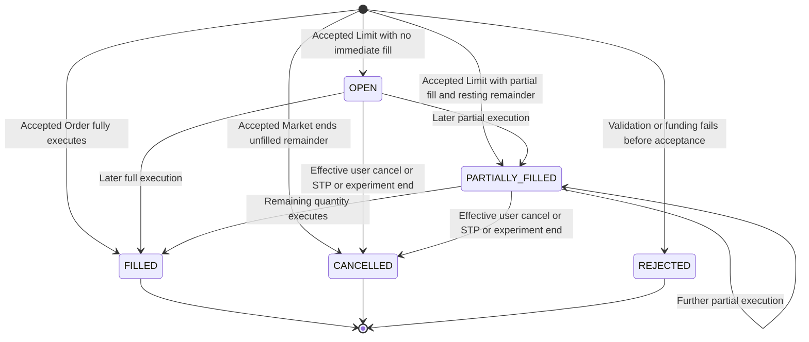

Acceptance is an event, not a NEW state. Terminal exits mean lifecycle completion, not deletion of historical facts. End trigger/timing remains [GAP-EXP-001](../review/gap-register.md#gap-exp-001)/[GAP-EXP-004](../review/gap-register.md#gap-exp-004); the diagram assumes end already effective. Earlier fills survive cancellation.

## [DIA-VALID](README.md#dia-valid) — Request validation and funding gate

Status: PROVISIONAL

Trace: [OQ-001](../decisions.md#oq-001) [OQ-004](../decisions.md#oq-004) [OQ-008](../decisions.md#oq-008) [OQ-017](../decisions.md#oq-017) [OQ-018](../decisions.md#oq-018) [OQ-019](../decisions.md#oq-019) [OQ-020](../decisions.md#oq-020) [OQ-021](../decisions.md#oq-021) [OQ-022](../decisions.md#oq-022) [OQ-027](../decisions.md#oq-027)

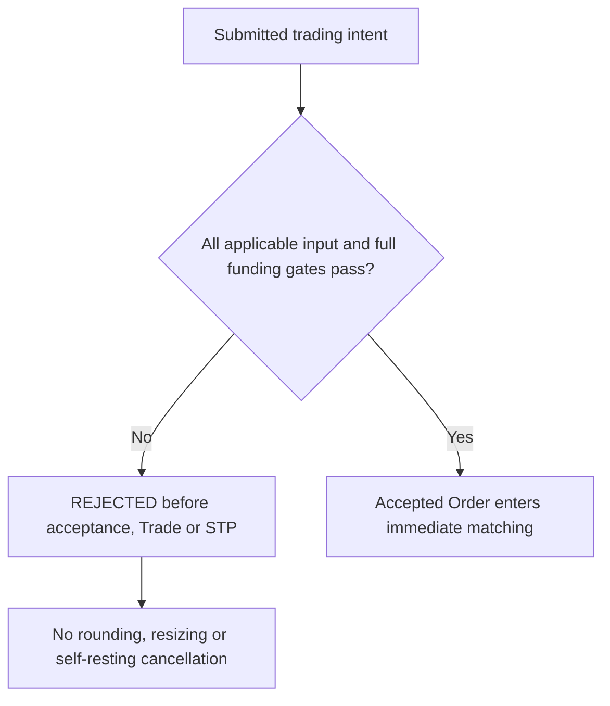

This combines gates without choosing which invalid reason is evaluated or reported first. Experiment time eligibility and repeated-submission identity are [GAP-EXP-004](../review/gap-register.md#gap-exp-004)/[GAP-ORD-001](../review/gap-register.md#gap-ord-001); valid input alone does not resolve them.

## [DIA-MATCH](README.md#dia-match) — Eligible selection and type remainder

Status: PROVISIONAL

Trace: [OQ-007](../decisions.md#oq-007) [OQ-008](../decisions.md#oq-008) [OQ-009](../decisions.md#oq-009) [OQ-010](../decisions.md#oq-010) [OQ-011](../decisions.md#oq-011) [OQ-012](../decisions.md#oq-012) [OQ-027](../decisions.md#oq-027) [OQ-031](../decisions.md#oq-031)

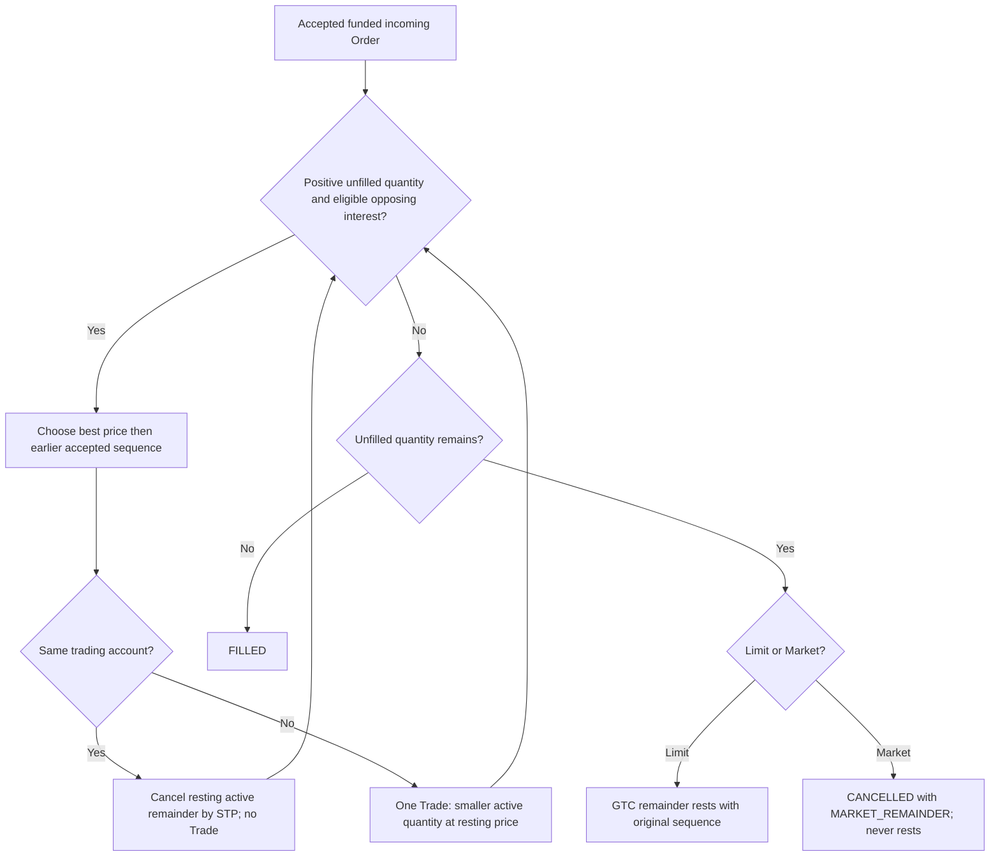

Eligibility includes symbol, side and both unit-price boundaries. [OQ-031](../decisions.md#oq-031) pair size/one-Trade granularity and [OQ-027](../decisions.md#oq-027) state labels make the whole diagram provisional. Reservation/settlement effects use [DIA-RESERVE](README.md#dia-reserve)/[DIA-SETTLE](README.md#dia-settle), not an invented diagram component.

## [DIA-STP](README.md#dia-stp) — Account-level prevention core

Status: APPROVED-DERIVED

Trace: [OQ-007](../decisions.md#oq-007) [OQ-011](../decisions.md#oq-011) [OQ-012](../decisions.md#oq-012) [TRD-INV-004](../invariants.md#trd-inv-004)

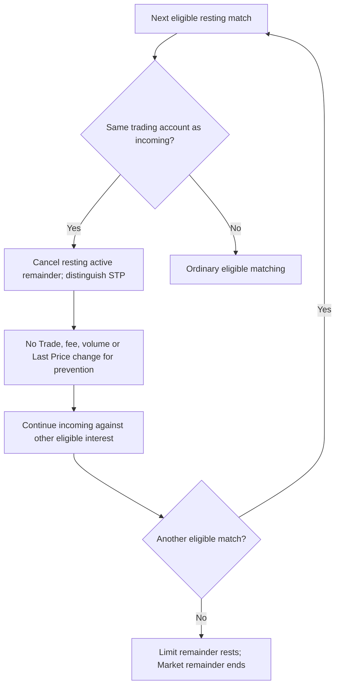

Approved prevention effect only. It does not assign proposed five-state labels, exact fee amounts, immediate settlement or reservation-release timing. Earlier legitimate fills remain facts. Different accounts are not grouped by human owner.

## [DIA-CANCEL](README.md#dia-cancel) — Participant cancellation result

Status: PROVISIONAL

Trace: [OQ-023](../decisions.md#oq-023) [OQ-026](../decisions.md#oq-026) [OQ-027](../decisions.md#oq-027) [OQ-031](../decisions.md#oq-031) [ORD-INV-004](../invariants.md#ord-inv-004) [BAL-INV-003](../invariants.md#bal-inv-003)

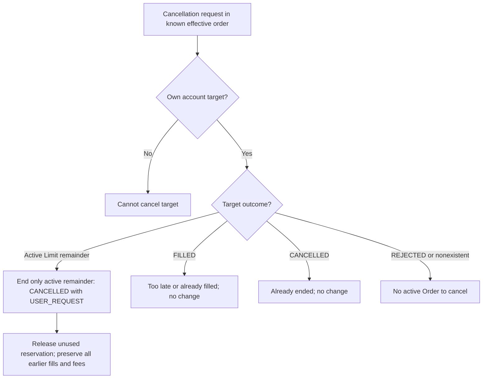

An outstanding request is not effectiveness and no CANCEL_PENDING is added. Equal scheduled arrival and end boundary are not decided by this graph; see [GAP-MAT-001](../review/gap-register.md#gap-mat-001)/[GAP-EXP-004](../review/gap-register.md#gap-exp-004).

## [DIA-PRECEDENCE](README.md#dia-precedence) — Fill / cancel precedence after order is known

Status: PROVISIONAL

Trace: [OQ-023](../decisions.md#oq-023) [OQ-026](../decisions.md#oq-026) [OQ-027](../decisions.md#oq-027) [OQ-031](../decisions.md#oq-031)

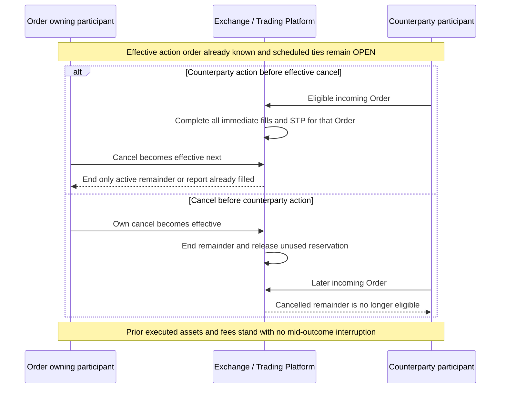

Displayed timestamps can be equal; arrows show authoritative business order rather than physical network timing. Experiment end follows the same proposed precedence principle only when its effective order is known.

## [DIA-RESERVE](README.md#dia-reserve) — Reservation lifecycle as financial effects

Status: PROVISIONAL

Trace: [OQ-021](../decisions.md#oq-021) [OQ-022](../decisions.md#oq-022) [OQ-023](../decisions.md#oq-023) [OQ-024](../decisions.md#oq-024) [OQ-027](../decisions.md#oq-027) [OQ-046](../decisions.md#oq-046) [BAL-INV-002](../invariants.md#bal-inv-002)

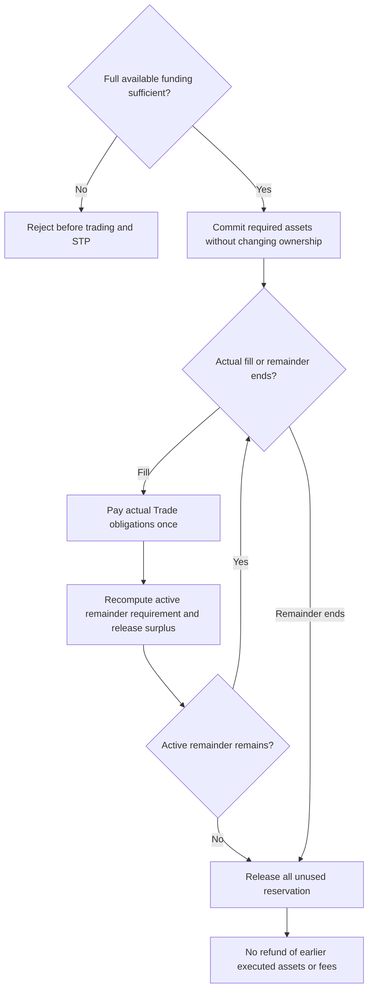

Nodes are effects, not new Reservation states. The no-event condition keeps the existing commitment. Repeated cancellation/reporting does not create another release.

## [DIA-SETTLE](README.md#dia-settle) — Per-Trade ownership and fee conservation

Status: PROVISIONAL

Trace: [OQ-014](../decisions.md#oq-014) [OQ-015](../decisions.md#oq-015) [OQ-016](../decisions.md#oq-016) [OQ-023](../decisions.md#oq-023) [OQ-024](../decisions.md#oq-024) [OQ-046](../decisions.md#oq-046) [STL-INV-002](../invariants.md#stl-inv-002) [STL-INV-003](../invariants.md#stl-inv-003)

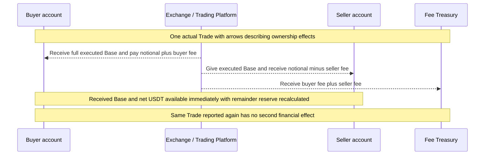

No unsettled stage or failure state is added. All effects describe one coherent settled Trade; the diagram does not prescribe execution mechanisms or intermediate observable imbalance.

## [DIA-ROLES](README.md#dia-roles) — One Limit Order changes execution role

Status: APPROVED-DERIVED

Trace: [OQ-007](../decisions.md#oq-007) [OQ-009](../decisions.md#oq-009) [OQ-012](../decisions.md#oq-012) [OQ-013](../decisions.md#oq-013) [OQ-014](../decisions.md#oq-014)

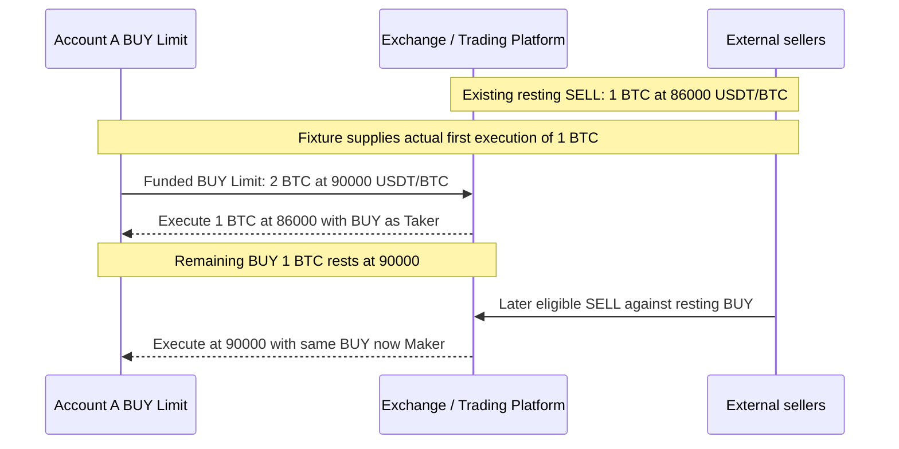

Role assignment and prices only; exact fees, five-state outcomes and settlement mechanics remain provisional in the composed financial scenario.

## [DIA-FUND](README.md#dia-fund) — Funding versus ordinary scenario liquidity

Status: PROVISIONAL

Trace: [OQ-003](../decisions.md#oq-003) [OQ-035](../decisions.md#oq-035) [OQ-036](../decisions.md#oq-036) [OQ-042](../decisions.md#oq-042) [OQ-043](../decisions.md#oq-043) [OQ-046](../decisions.md#oq-046) [SIM-INV-001](../invariants.md#sim-inv-001)

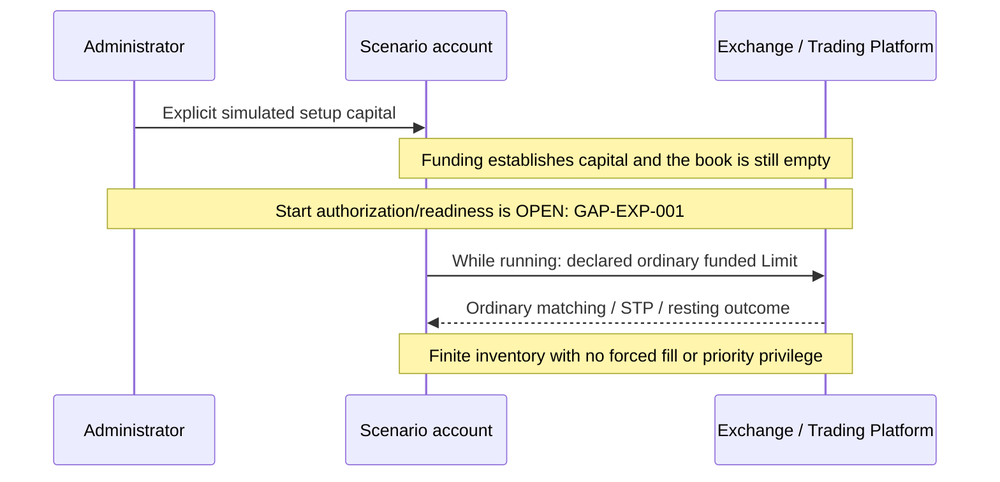

Setup-only and while-running submission depend on proposed decisions. The funding prohibition itself is approved [OQ-003](../decisions.md#oq-003); the diagram does not promise a resting outcome when existing interest crosses the scheduled Limit.

## [DIA-EXP](README.md#dia-exp) — Conditional end and separate run

Status: PROVISIONAL with OPEN control nodes

Trace: [OQ-023](../decisions.md#oq-023) [OQ-027](../decisions.md#oq-027) [OQ-031](../decisions.md#oq-031) [OQ-035](../decisions.md#oq-035) [OQ-039](../decisions.md#oq-039) [OQ-042](../decisions.md#oq-042) [OQ-045](../decisions.md#oq-045)

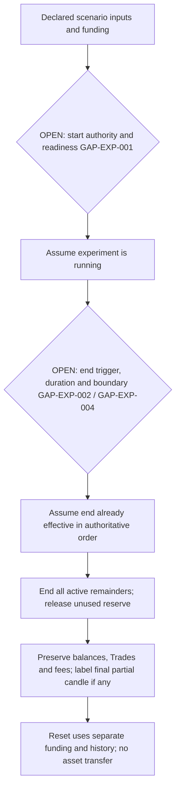

OPEN diamonds are unresolved policy, not confirmed transitions. The source does not define a general pause/resume feature, required duration, manual end or automatic end; running/ended labels here are prose conditions, not new enum states.

## [DIA-DATA](README.md#dia-data) — Trade versus non-Trade observation effects

Status: PROVISIONAL

Trace: [OQ-003](../decisions.md#oq-003) [OQ-011](../decisions.md#oq-011) [OQ-037](../decisions.md#oq-037) [OQ-038](../decisions.md#oq-038) [OQ-039](../decisions.md#oq-039) [OQ-044](../decisions.md#oq-044)

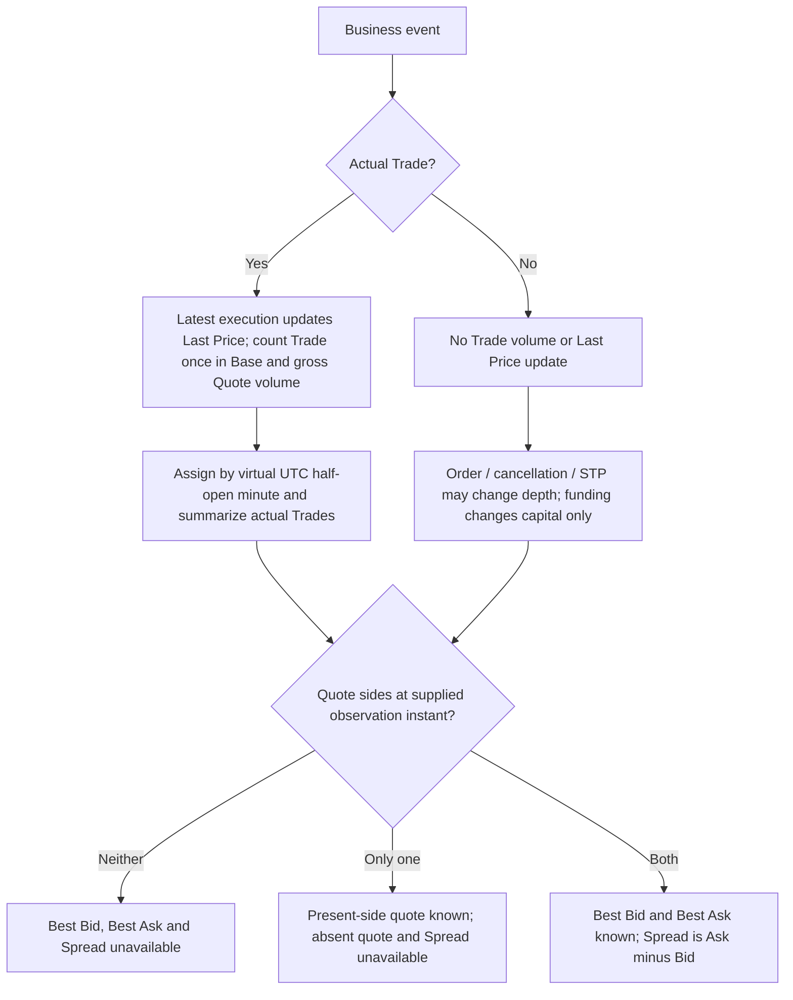

No first Trade means Last Price stays unavailable. Quote branches apply to supplied book facts at a known observation instant; quotes can exist before the first Trade and a historical Last Price can exist after the book becomes empty. This is derived data content, not a chosen observation delivery or sampling policy ([GAP-MKT-001](../review/gap-register.md#gap-mkt-001)/[GAP-HFT-002](../review/gap-register.md#gap-hft-002)).

## [DIA-CANDLE](README.md#dia-candle) — Half-open minute boundary

Status: PROVISIONAL

Trace: [OQ-035](../decisions.md#oq-035) [OQ-038](../decisions.md#oq-038) [OQ-039](../decisions.md#oq-039)

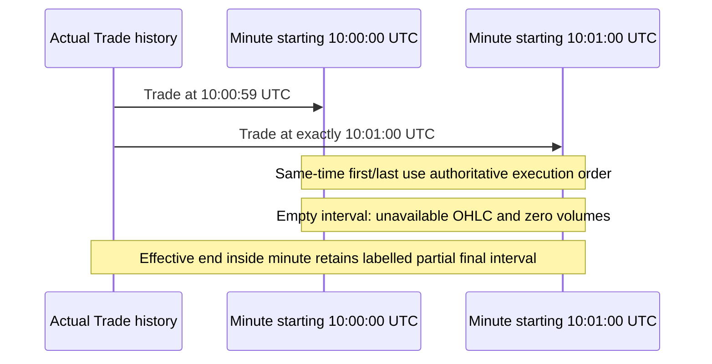

Times illustrate virtual grouping, not experiment-duration presets. A Trade exactly at experiment end is not authorized by this candle diagram; end eligibility remains [GAP-EXP-004](../review/gap-register.md#gap-exp-004).

## [DIA-PF](README.md#dia-pf) — Indicative position valuation

Status: PROVISIONAL

Trace: [OQ-033](../decisions.md#oq-033) [OQ-034](../decisions.md#oq-034) [OQ-044](../decisions.md#oq-044) [OQ-046](../decisions.md#oq-046)

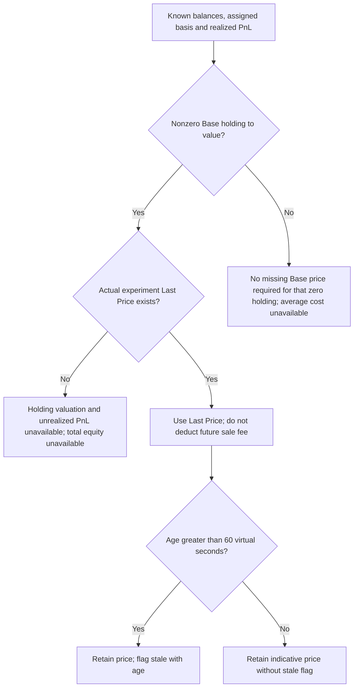

Known balances/realized PnL stay available when valuation is missing. Exactly 60 is not greater than 60. Setup acquisition reference is not a valuation fallback. Clock progression after end remains OPEN.

## [DIA-LATENCY](README.md#dia-latency) — Observation / decision / action distinction

Status: PROVISIONAL

Trace: [OQ-010](../decisions.md#oq-010) [OQ-031](../decisions.md#oq-031) [OQ-035](../decisions.md#oq-035) [OQ-041](../decisions.md#oq-041)

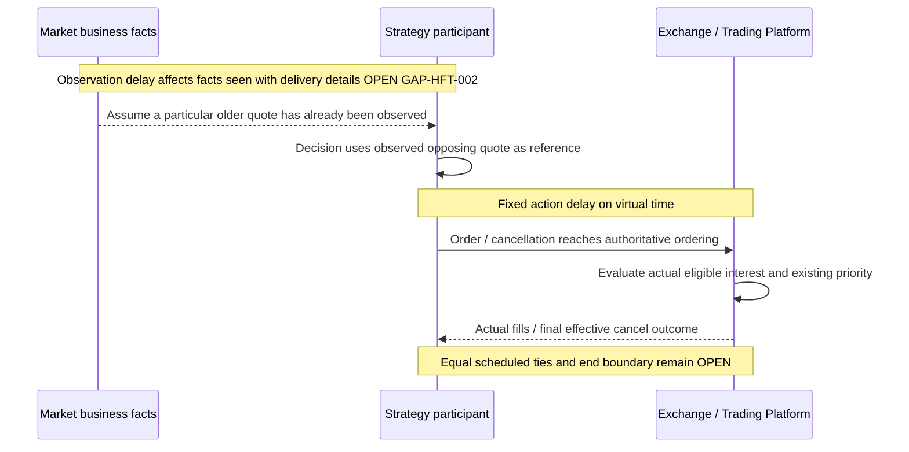

A fixture can supply known observation and effective action order. It cannot infer delivery semantics, clock precision, identical-arrival tie policy or timing metric origin.

## [DIA-OBS](README.md#dia-obs) — Observation meaning needs a business decision

Status: OPEN / BLOCKED

Trace: [OQ-037](../decisions.md#oq-037) [OQ-041](../decisions.md#oq-041) [GAP-MKT-001](../review/gap-register.md#gap-mkt-001) [GAP-HFT-002](../review/gap-register.md#gap-hft-002)

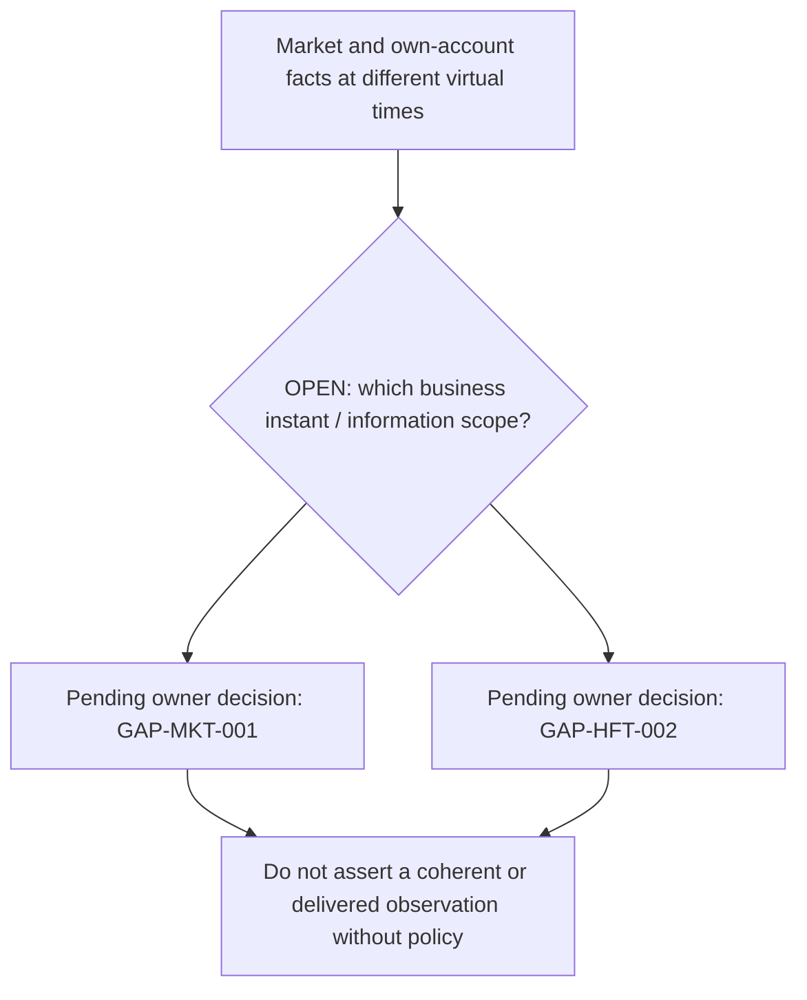

This diagram records a gap, not a fictional delivered-observation lifecycle. No coalescing, ordering, sampling, private-update delay or post-end delivery alternative is selected.

## [DIA-METRICS](README.md#dia-metrics) — Fill metrics and unresolved elapsed origin

Status: PROVISIONAL with OPEN timing node

Trace: [OQ-041](../decisions.md#oq-041) [OQ-046](../decisions.md#oq-046) [GAP-HFT-003](../review/gap-register.md#gap-hft-003)

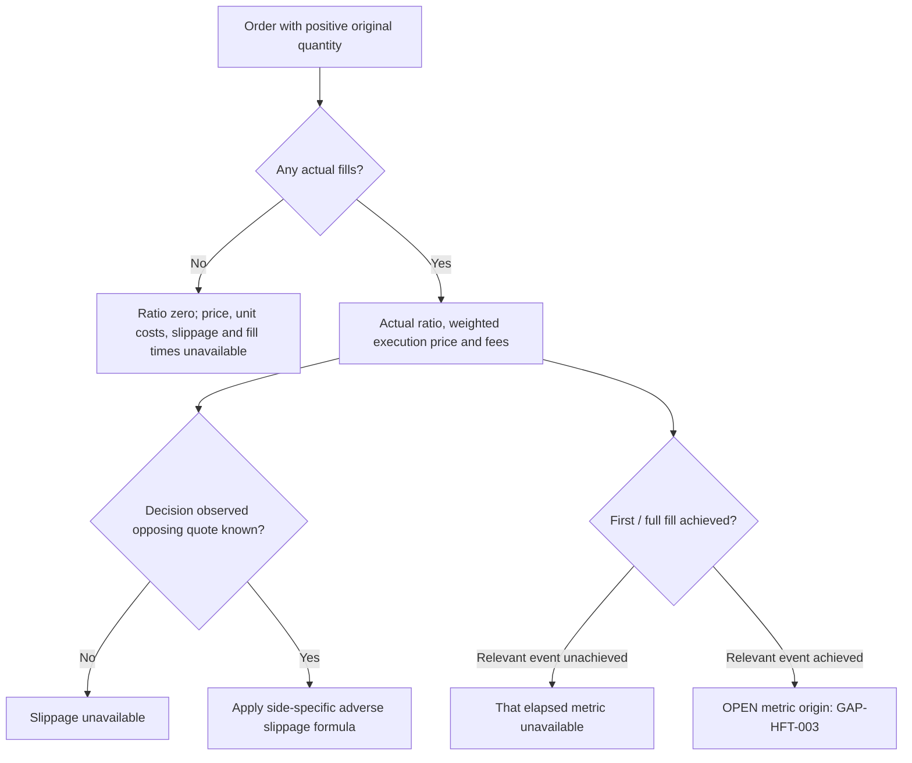

With partial fills, first fill may be achieved while full fill is unachieved. This diagram does not label an achieved elapsed time zero or choose its start event.
